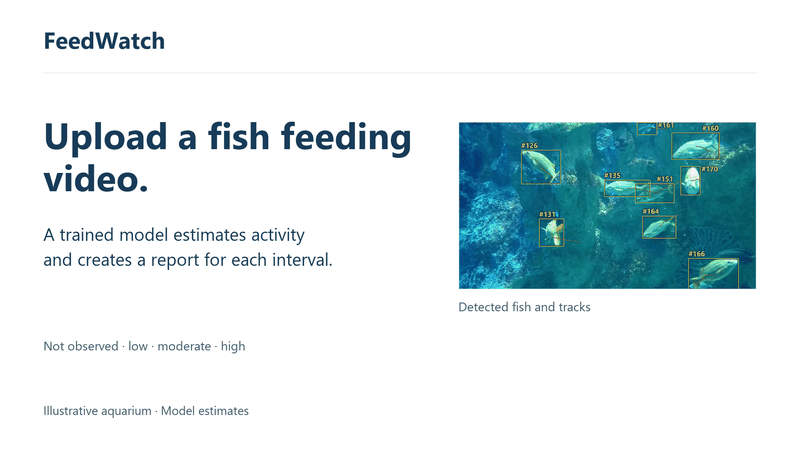
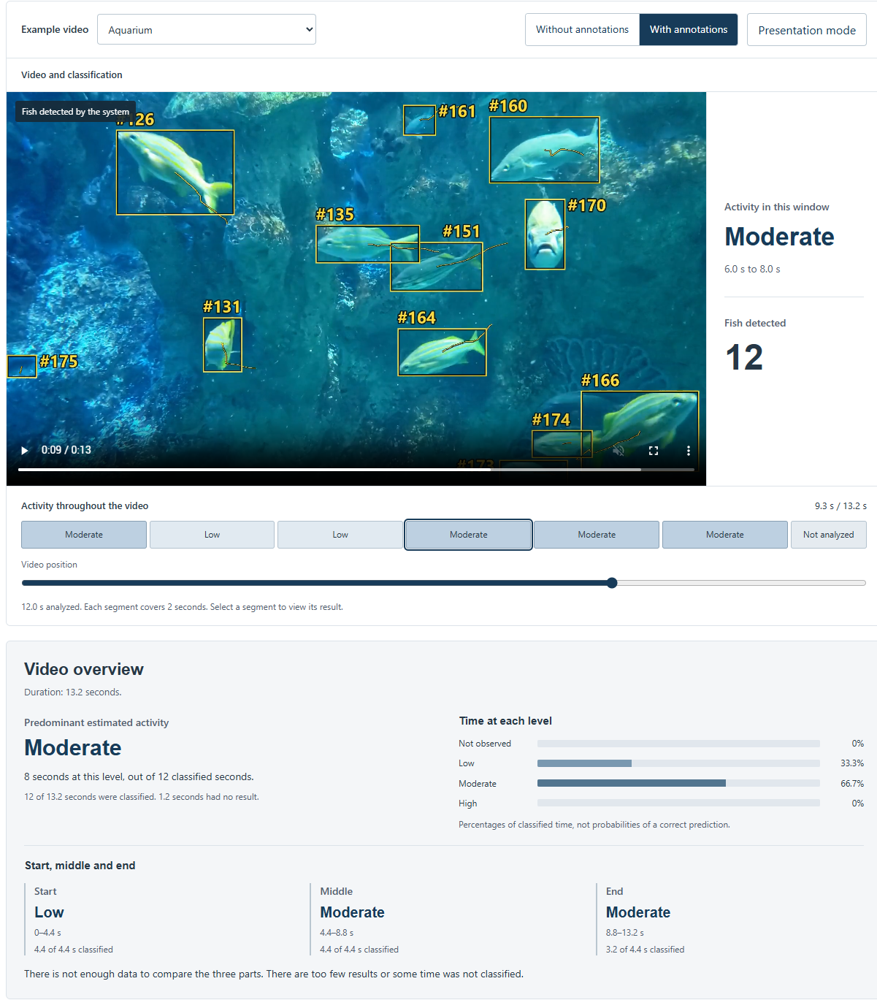

# FeedWatch

**English** | [Português](README.pt-BR.md)

Upload a video of fish during feeding. FeedWatch uses a trained model to estimate feeding intensity in two-second intervals and produces a report with time ranges for each result.



Example estimates in the report: `00:00–00:02 · moderate` and `00:02–00:04 · low`. Times refer to positions in the uploaded video.

[Download the Full HD demonstration video](https://github.com/williamosilva/feedwatch/releases/download/v0.1.0/feedwatch-grid-clean-en.mp4)

The aquarium segment shows real detection and tracking output. This footage was not used to train the feeding classifier and has no feeding activity labels. Video: [Richard Muller / Pexels](https://www.pexels.com/video/fishes-swimming-in-aquarium-6472322/) ([license](https://www.pexels.com/license/)).

## Features

- Assigns each two-second window a feeding activity level: not observed, low, moderate or high.
- Shows detected fish and their tracks.
- Displays a synchronized motion map and a graph of apparent image movement.
- Summarizes time at each level and compares the start, middle and end of a video.
- Exports annotated video and analysis results.

This prototype runs locally. A frozen MobileNetV3 Small extracts features; a GRU trained on AV-FFIA classifies feeding activity. Separate Fishial models detect fish. The application accepts videos from 2 to 60 seconds, up to 100 MB. The interface starts in English and includes a Portuguese language selector.

The motion map highlights changes between consecutive original frames. It includes water and reflections; its colors represent image motion, separately from the feeding estimate.

<details>
<summary>Interface and video overview</summary>



</details>

## Run locally

Requires Python 3.12. On Windows, open PowerShell in the project folder:

```powershell
py -3.12 -m venv .venv
.\.venv\Scripts\python.exe -m pip install torch==2.10.0 torchvision==0.25.0 --index-url https://download.pytorch.org/whl/cpu
.\.venv\Scripts\python.exe -m pip install -e ".[local]"
```

Download the [runtime package](https://github.com/williamosilva/feedwatch/releases/download/v0.1.0/feedwatch-runtime.zip) and extract it into the project folder. It contains the trained classifier, feature extractor and an aquarium video. You do not need to retrain the model or download the datasets to use the application.

Download the fish detectors and start the application:

```powershell
.\.venv\Scripts\python.exe -m feedwatch prepare-fish-detector
.\.venv\Scripts\python.exe -m feedwatch serve
```

Open `http://127.0.0.1:7860`. These installation commands use CPU.

## Experiment videos

Official AV-FFIA data by Meng Cui and colleagues (CC BY 4.0). These downloads are for reproducing the experiments; the application uses pretrained weights.

| Download | Size | Use in this project |
|---|---:|---|
| [June 19–22, 2022](https://zenodo.org/api/records/11059975/files/video_6.19-6.22.zip/content) | 21.76 GB | Training, validation and testing of the current model |
| [June 13–18, 2022](https://zenodo.org/api/records/11060195/files/video_6.13-6.18.zip/content) | 30.67 GB | Additional training experiment; candidate not adopted |
| [June 27–29, 2022](https://zenodo.org/api/records/11060195/files/video_6.27-6.29.zip/content) | 13.05 GB | Additional evaluation sample |

The current model used 3,898 training clips (June 19–20), 1,705 validation clips (June 21) and 1,501 test clips (June 22). Extract the first dataset into `video_6.19-6.22` to reproduce these experiments.

## Results and limitations

| Current model evaluation | Clips | Accuracy | Macro-F1 |
|---|---:|---:|---:|
| June 22, 2022 test set | 1,501 | 60.56% | 0.5903 |
| June 27–29, 2022 sample | 224 | 53.57% | 0.4914 |

Training with additional days improved the moderate category but reduced performance on high activity. The previous model was retained.

Predictions do not determine hunger, feed quantities or cost savings. Fish counts apply to individual frames. Validation of continuous feeding sessions by human reviewers is still pending.

[Method](docs/methodology.md) · [Full evaluation](docs/evaluation.md) · [Evidence](evidence/independent-results.json)

## References

- [Cui et al. — Multimodal Fish Feeding Intensity Assessment in Aquaculture](https://arxiv.org/abs/2309.05058v3): AV-FFIA/U-FFIA study. FeedWatch uses video only.
- [U-FFIA](https://github.com/FishMaster93/U-FFIA): the authors' code.
- [Fishial](https://github.com/Wye-Foundation/Fishial-Fish-Identification): pretrained fish detectors.
- [FAO — On-farm feeding and feed management in aquaculture](https://www.fao.org/4/i3481e/i3481e00.htm): feeding management reference.
- [NOAA — 5 Things to Know About Aquafeeds](https://www.fisheries.noaa.gov/feature-story/5-things-know-about-aquafeeds): cameras for monitoring feeding.

## Tests

```powershell
.\.venv\Scripts\python.exe -m unittest discover -s tests
.\.venv\Scripts\python.exe -m pip check
```

## License

Code is licensed under [AGPL-3.0](LICENSE). Data, models and videos retain their own licenses: see [third-party credits](THIRD_PARTY.md). Videos, weights, datasets and local run outputs are excluded from Git.
