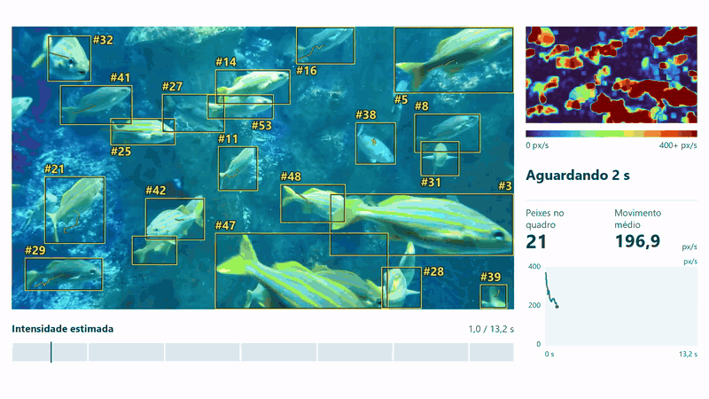
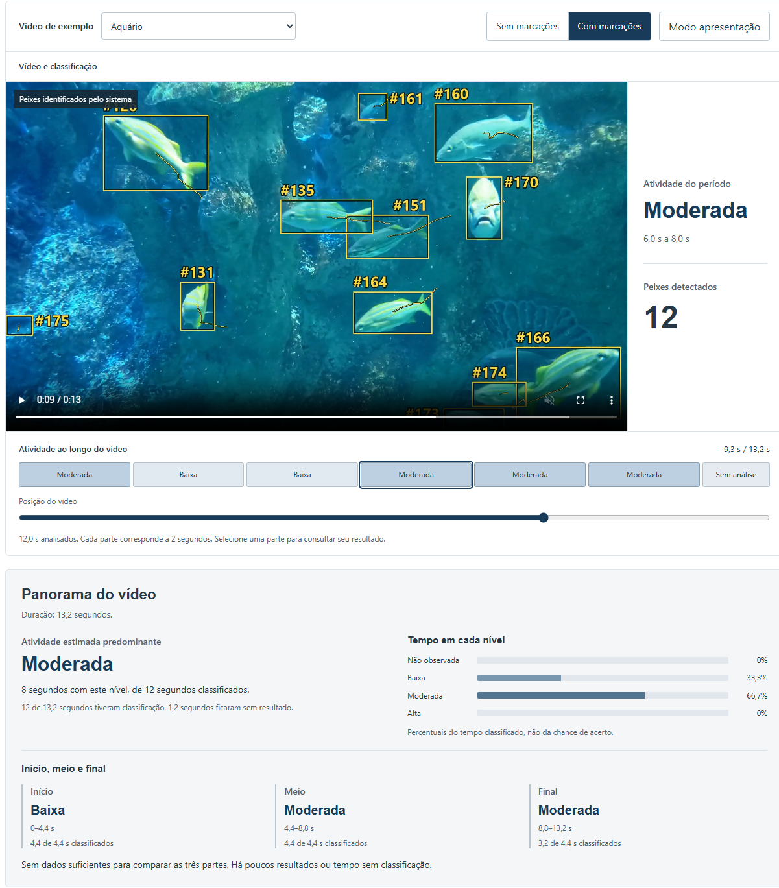

# FeedWatch

[English](README.md) | **Português**

Envie um vídeo dos peixes durante a alimentação. O FeedWatch usa um modelo treinado para estimar a intensidade em trechos de dois segundos e gerar um relatório com os tempos de cada resultado.



Exemplos de estimativas no relatório: `00:00–00:02 · moderada` e `00:02–00:04 · baixa`. Os tempos correspondem à posição no vídeo enviado.

O trecho do aquário mostra uma saída real da detecção e do rastreamento. Essa gravação não foi usada no treinamento do classificador nem possui rótulos de atividade alimentar. Vídeo: [Richard Muller / Pexels](https://www.pexels.com/video/fishes-swimming-in-aquarium-6472322/) ([licença](https://www.pexels.com/license/)).

## Funcionamento

- Classifica períodos de dois segundos em atividade não observada, baixa, moderada e alta.
- Mostra peixes detectados e trajetórias.
- Exibe um mapa de movimento sincronizado e um gráfico do movimento aparente da imagem.
- Resume o tempo em cada nível e compara início, meio e final.
- Exporta o vídeo e os resultados para conferência.

Este protótipo roda localmente. Uma MobileNetV3 Small congelada extrai características; uma GRU treinada com AV-FFIA classifica a atividade. A detecção usa modelos Fishial separados. A aplicação aceita vídeos de 2 a 60 segundos, com até 100 MB. A interface inicia em inglês e permite alternar para português.

O mapa destaca mudanças entre imagens consecutivas da gravação original. Inclui água e reflexos; as cores representam movimento da imagem, separado da estimativa alimentar.

Os números nas caixas são IDs temporários de rastreamento. O rastreador usa movimento, cor e textura para recuperar interrupções curtas, de até um segundo. Peixes parecidos e ocultações longas ainda podem causar mudanças de ID. Esses números não determinam a intensidade alimentar. Veja a [comparação do rastreamento](evidence/tracking-continuity.json).

<details>
<summary>Interface e panorama do vídeo</summary>



</details>

## Executar

Requer Python 3.12. No Windows, abra o PowerShell na pasta do projeto:

```powershell
py -3.12 -m venv .venv
.\.venv\Scripts\python.exe -m pip install torch==2.10.0 torchvision==0.25.0 --index-url https://download.pytorch.org/whl/cpu
.\.venv\Scripts\python.exe -m pip install -e ".[local]"
```

Extraia o [pacote com os pesos treinados e o vídeo de aquário](https://github.com/williamosilva/feedwatch/releases/download/v0.1.0/feedwatch-runtime.zip) na pasta do projeto. Depois, prepare os detectores e inicie:

```powershell
.\.venv\Scripts\python.exe -m feedwatch prepare-fish-detector
.\.venv\Scripts\python.exe -m feedwatch serve
```

Abra `http://127.0.0.1:7860`. Estes comandos usam CPU. Você pode analisar seus vídeos ou usar o exemplo incluído no pacote. Não é necessário treinar o modelo nem baixar os datasets para executar a aplicação.

## Vídeos usados nos experimentos

Dados oficiais AV-FFIA, de Meng Cui e colaboradores (CC BY 4.0). Os downloads abaixo servem para repetir os experimentos.

| Download | Tamanho | Uso no projeto |
|---|---:|---|
| [Vídeos de 19–22/06/2022](https://zenodo.org/api/records/11059975/files/video_6.19-6.22.zip/content) | 21,76 GB | Treino, validação e teste do modelo atual |
| [Vídeos de 13–18/06/2022](https://zenodo.org/api/records/11060195/files/video_6.13-6.18.zip/content) | 30,67 GB | Retreinamento adicional não aprovado |
| [Vídeos de 27–29/06/2022](https://zenodo.org/api/records/11060195/files/video_6.27-6.29.zip/content) | 13,05 GB | Amostra adicional de avaliação |

O modelo atual usou 3.898 clipes no treino (dias 19–20), 1.705 na validação (dia 21) e 1.501 no teste (dia 22). Para repetir esses experimentos, extraia os dados em `video_6.19-6.22`.

## Resultados e limites

| Avaliação do modelo atual | Clipes | Acerto | Macro-F1 |
|---|---:|---:|---:|
| Teste de 22/06/2022 | 1.501 | 60,56% | 0,5903 |
| Amostra de 27–29/06/2022 | 224 | 53,57% | 0,4914 |

O retreinamento com mais dias melhorou a categoria moderada, mas piorou a alta. O modelo anterior foi mantido.

Também ajustei as últimas camadas da MobileNet com pequenas variações de imagem, usando os mesmos vídeos de treino. O resultado médio na validação melhorou, mas o candidato não atingiu os critérios de substituição. A aplicação mantém o modelo original. [Método, resultados e curvas do ajuste](docs/finetuning.md).

As previsões não determinam fome, quantidade de ração ou economia. A contagem é por imagem. A validação de sessões contínuas com revisores ainda está pendente.

[Método](docs/methodology.md) · [Avaliação completa](docs/evaluation.md) · [Evidências](evidence/independent-results.json)

## Referências

- [Cui et al. — Multimodal Fish Feeding Intensity Assessment in Aquaculture](https://arxiv.org/abs/2309.05058v3): estudo do AV-FFIA/U-FFIA. O FeedWatch usa somente vídeo.
- [U-FFIA](https://github.com/FishMaster93/U-FFIA): código dos autores.
- [Fishial](https://github.com/Wye-Foundation/Fishial-Fish-Identification): detectores pré-treinados de peixes.
- [FAO — On-farm feeding and feed management in aquaculture](https://www.fao.org/4/i3481e/i3481e00.htm): referência de manejo alimentar.
- [NOAA — 5 Things to Know About Aquafeeds](https://www.fisheries.noaa.gov/feature-story/5-things-know-about-aquafeeds): câmeras no acompanhamento da alimentação.

## Testes

```powershell
.\.venv\Scripts\python.exe -m unittest discover -s tests
.\.venv\Scripts\python.exe -m pip check
```

## Licença

Código sob [AGPL-3.0](LICENSE). Dados, modelos e vídeos mantêm suas próprias licenças: [créditos](THIRD_PARTY.md). Vídeos, pesos, datasets e arquivos de execução ficam fora do Git.
